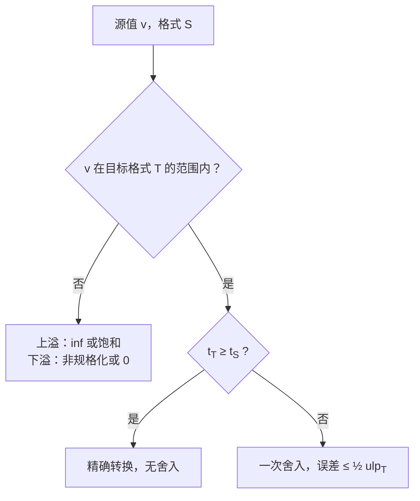

本篇是浮点数系列的第二篇，主题是浮点数的舍入和转换逻辑。浮点数的舍入是相同类型的浮点数在完成运算（一般需要更多位宽）后回到固定位宽的过程，而转换则是不同类型的浮点数映射的过程，从高精度浮点数转换到低精度浮点数一般也会涉及到舍入。

## 舍入

IEEE 754-2019定义了舍入：每条运算都等同于先产生一个无限精度、无范围限制的中间结果，再按某种舍入模式把这个结果舍入到目标类型。它保证一次运算只产生一次舍入。[^754-rounding]

IEEE 754-2019定义了5种舍入模式，如下表所示[^754-modes]：

| 属性                  | 缩写  | C `fenv`               | PTX               | 语义                        |
| ------------------- | --- | ---------------------- | ----------------- | ------------------------- |
| roundTiesToEven     | RNE | `FE_TONEAREST`         | `cvt.rn.*`        | 四舍六入五成双，取最近；平局取最低有效位为0的邻点 |
| roundTiesToAway     | RNA | `FE_TONEARESTFROMZERO` | `cvt.rna.*`（tf32） | 四舍五入，取最近；平局取量值更大者         |
| roundTowardPositive | RTP | `FE_UPWARD`            | `cvt.rp.*`        | 向上舍入，朝 $+\infty$          |
| roundTowardNegative | RTN | `FE_DOWNWARD`          | `cvt.rm.*`        | 向下舍入，朝 $-\infty$          |
| roundTowardZero     | RTZ | `FE_TOWARDZERO`        | `cvt.rz.*`        | 向零舍入，朝 0，即按量值截断           |

`RNA`是唯一一种不强制实现的舍入模式。[^754-rna-optional]

这里面前两种属于最近舍入，后三种属于定向舍入。默认的浮点数舍入模式采用第一种。

### 舍入误差

选择不同的舍入模式会造成不同的舍入误差，沿用 [浮点数的表示](https://gucarpenter.github.io/zh/blog/floating-point-representation/) 中的符号：$n$ 是尾数位，$t=n+1$ 是有效位数，$E$ 是解码后的指数。

对于最近舍入来说，结果与精确值的距离不超过半个 ulp。对一个 binade $|x|\in[2^{E},2^{E+1})$，网格间距是 $\operatorname{ulp}(x)=2^{E-n}$，于是

$$
|fl(x)-x| \le 2^{E-n-1},
$$

而 $|x|\ge 2^{E}$，两者相除给出相对误差，这也是默认的舍入误差：

$$
\frac{|fl(x)-x|}{|x|} \le \frac{2^{E-n-1}}{2^{E}} = 2^{-n-1} = 2^{-t} =: u .
$$

因此得到浮点数的标准模型[^higham-model]

$$
fl(x) = x(1+\delta), \qquad |\delta| \le u .
$$

对于定向舍入来说，结果与精确值可能相距将近一整个 ulp，$|fl(x)-x|<\operatorname{ulp}(x)$，相对误差随之变成 $|\delta|<2^{-n}=2u$。

把 $n$ 代进去，可以得到各种浮点数类型的舍入误差：

| 格式 | $n$ | $t=n+1$ | $u=2^{-t}$ | $\epsilon_M=2^{-n}=\operatorname{ulp}(1)$ |
| --- | --- | --- | --- | --- |
| FP64 | 52 | 53 | $1.11\times10^{-16}$ | $2.22\times10^{-16}$ |
| FP32 | 23 | 24 | $5.96\times10^{-8}$ | $1.19\times10^{-7}$ |
| FP16 | 10 | 11 | $4.88\times10^{-4}$ | $9.77\times10^{-4}$ |
| TF32 | 10 | 11 | $4.88\times10^{-4}$ | $9.77\times10^{-4}$ |
| BF16 | 7 | 8 | $3.91\times10^{-3}$ | $7.81\times10^{-3}$ |

注意到机器精度刚好是两倍的舍入误差：$\epsilon_M=\operatorname{ulp}(1)=2u$，这不是巧合，由两者的公式就可得到。

### 默认舍入模式`RNE`

现在我们可以回头来回答为什么默认的舍入模式是`RNE`了。从上面的分析可以得到，就近舍入的舍入误差是定向舍入的一半，因此就近舍入是误差更小的选择。那么为什么要选择`RNE`而不是`RNA`呢？

假设平局事件在两个方向上对称地出现。如果恒定朝一个方向处理平局（`RNA`），期望偏置是 $\tfrac12\operatorname{ulp}\times P(\text{平局})$，符号固定，在长求和里可能累积成可见漂移。如果选择 `RNE`，那么向上舍入和向下舍入的概率相等，期望偏置是0[^csapp-rne]。以BF16的$[1, 2)$ 指数区间为例，区间距ulp是$2^{-7}$， 区间内有128个平局中点，在 `RNE` 下64个会舍入到1，64个舍入到2。而在 `RNA` 下，128个都会舍入到2。

### 截断舍入模式 `RTZ`

在对精度要求没有那么严格的场景中，另一种也很常见的舍入模式就是截断舍入模式 `RTZ`。因为截断舍入的硬件实现比较简单，因此性能也更好。

## 转换

从源格式转换成目标格式是否无损，需要关注两个维度，分别决定了精度和范围。

- **尾数**：$t_{\text{目标}}\ge t_{\text{源}}$ 才可能无损，否则需要有一次舍入；
- **指数范围**：目标要覆盖源的每一个值才可能无损，否则边界之外上溢或下溢。

把真实的格式对填进这张表：

| | 尾数够 $t_T \ge t_S$ | 尾数不够 $t_T < t_S$ |
| --- | --- | --- |
| **范围够** | 精确：fp16→fp32、bf16→fp32、tf32→fp32 | 一次舍入：fp32→tf32、fp32→bf16、fp16→bf16 |
| **范围不够** | 精确但可能出界：bf16→fp16 | 一次舍入且可能出界：fp32→fp16 |

从这里就可以看到，如果使用bf16混精训练，向上转换到fp32的过程是无损的，只有向下转换回bf16会有一次舍入误差。但如果使用fp16混精训练，不仅有舍入误差还可能出界。

### 三种有损的转换

由此可以得到三种有损的转换：

| 形态       | 判据                    | 误差                                                | 例子（FP32 → FP16 RNE）                               |
| -------- | --------------------- | ------------------------------------------------- | ------------------------------------------------- |
| 丢精度      | 落在目标规格化区内，不在格点上       | 绝对 $\le\tfrac12\operatorname{ulp}_T$，相对 $\le u_T$ | —                                                 |
| 上溢       | 无界舍入后超过最大有限值          | 无界                                                | $65504\to65504$；$65520\to\infty$；$65536\to\infty$ |
| 下溢进非规格化区 | 落在 $(0,2^{E_{\min}})$ | 绝对误差界有效，相对误差界失效                                   | $1.0\times10^{-5}\to1.00135803\times10^{-5}$      |

丢精度的场景就是上面分析的舍入场景，存在一次舍入误差。

上溢的场景在[浮点数的表示 › 上溢](https://gucarpenter.github.io/zh/blog/floating-point-representation/)中有过初步的说明，这里结合不同的舍入模式给出一个更清晰的例子。把三个代表性输入送进 FP32→FP16：

| 输入 | RNE | RNA | RTP | RTN | RTZ |
| --- | --- | --- | --- | --- | --- |
| $65519.9$ | $65504$ | $65504$ | $+\infty$ | $65504$ | $65504$ |
| $65520$ | $+\infty$ | $+\infty$ | $+\infty$ | $65504$ | $65504$ |
| $-65520$ | $-\infty$ | $-\infty$ | $-65504$ | $-\infty$ | $-65504$ |

为什么会是65520这个特殊的值，因为FP16的最后一个指数区间是$[2^{15}, 2^{16})$，对应的区间距是$ulp=2^{15-10}=32$, 对应的最大有限值是65504，下一个点就是65536，对应的中间就是65520。对于略小于这个值的数，除了RTP会向上舍入到无穷，其他都正常舍入到65504。但到了65520，只有RTN向下舍入和RTZ向零舍入才能回到65504。对于-65520来说，类似的只有RTP向上舍入和RTZ向零舍入才能回到-65504。[^754-overflow]

下溢的场景在[浮点数的表示 › 下溢](https://gucarpenter.github.io/zh/blog/floating-point-representation/)中也有过说明，也是这三种场景中最晦涩的一种。由于FP16的最小正规格化数是$2^{-14}\approx 6.10\times10^{-5}$， 而FP32的最小正规格化数达到了$2^{-126}\approx 1.18\times10^{-38}$， 因此对于$1.0\times10^{-5}$这样的数，在FP32中以正规格化数表示，在FP16中只能以非规格化数表示了。FP16 的 $E_{\min}=-14$、$n=10$，所以非规格化区的间距是 $2^{-24}=5.9604645\times10^{-8}$。输入 $10^{-5}$ 除以它得

$$
\frac{10^{-5}}{2^{-24}} = 167.77216 ,
$$

最近舍入取 168，于是结果是 $168\times 2^{-24} = 1.00135803\times10^{-5}$。这个值有 $n'=\lfloor\log_2 168\rfloor+1 = 8$ 位有效数字，比规格化区的 11 位少了 3 位——这就是"相对误差界失效"的具体含义：绝对间距固定在 $2^{-24}$，量级越小，相对误差界越大。

值得注意的是不同舍入模式也影响了下溢的值[^754-underflow]。上面的讨论是基于默认的`RNE` 模式，下表把结果写成 $k\cdot 2^{-24}$ 的形式，$2^{-24}=5.9604645\times10^{-8}$ 就是非规格化区的间距：

| 输入（精确值）               | RNE               | RNA               | RTP               | RTN                | RTZ                |
| --------------------- | ----------------- | ----------------- | ----------------- | ------------------ | ------------------ |
| $2^{-26}$             | $0$               | $0$               | $2^{-24}$         | $0$                | $0$                |
| $2^{-25}$（平局）         | $0$               | $2^{-24}$         | $2^{-24}$         | $0$                | $0$                |
| $1.0\times10^{-5}$    | $168\cdot2^{-24}$ | $168\cdot2^{-24}$ | $168\cdot2^{-24}$ | $167\cdot2^{-24}$  | $167\cdot2^{-24}$  |
| $2^{-14}-2^{-25}$（平局） | $2^{-14}$         | $2^{-14}$         | $2^{-14}$         | $1023\cdot2^{-24}$ | $1023\cdot2^{-24}$ |

## CUDA 对舍入和转换的支持

### 显式舍入内建函数

| intrinsic  | `_rn` | `_rz` | `_ru` | `_rd` |
| ---------- | ----- | ----- | ----- | ----- |
| `__fadd`   | ✓     | ✓     | ✓     | ✓     |
| `__fsub`   | ✓     | ✓     | ✓     | ✓     |
| `__fmul`   | ✓     | ✓     | ✓     | ✓     |
| `__fmaf`   | ✓     | ✓     | ✓     | ✓     |
| `__fdiv`   | ✓     | ✓     | ✓     | ✓     |
| `__frcp`   | ✓     | ✓     | ✓     | ✓     |
| `__fsqrt`  | ✓     | ✓     | ✓     | ✓     |
| `__frsqrt` | ✓     | —     | —     | —     |

除了最后一个内建函数，其他都支持四种舍入模式。[^cuda-intrinsics]

### 窄格式转换

| 函数                 | `_rn` | `_rz` | `_ru` | `_rd` | 无后缀     |
| ------------------ | ----- | ----- | ----- | ----- | ------- |
| `__float2half`     | ✓     | ✓     | ✓     | ✓     | = `_rn` |
| `__float2bfloat16` | ✓     | ✓     | ✓     | ✓     | = `_rn` |
| `__half2float`     | —     | —     | —     | —     | 精确，无舍入  |
| `__bfloat162float` | —     | —     | —     | —     | 精确，无舍入  |

类似的，对于FP32→BF16和FP32→FP16，也支持四种舍入模式。而反向的转换不需要舍入。[^cuda-half]

[^754-rounding]: IEEE (2019), _IEEE Standard for Floating-Point Arithmetic_, IEEE Std 754-2019, §4.3 "Rounding-direction attributes", p. 27.
[^754-modes]: IEEE (2019), _IEEE Standard for Floating-Point Arithmetic_, §4.3.1 "Rounding-direction attributes to nearest" and §4.3.2 "Directed rounding attributes", pp. 27–28.
[^754-rna-optional]: IEEE (2019), _IEEE Standard for Floating-Point Arithmetic_, §4.3.3 "Rounding attribute requirements", p. 28.
[^higham-model]: Nicholas J. Higham (2002), _Accuracy and Stability of Numerical Algorithms_, 2nd ed., §2.2 "Model of Arithmetic", p. 40.
[^csapp-rne]: Randal E. Bryant and David R. O'Hallaron (2016), _Computer Systems: A Programmer's Perspective_, 3rd ed., §2.4.4 "Rounding", pp. 156–157.
[^754-overflow]: IEEE (2019), _IEEE Standard for Floating-Point Arithmetic_, §7.4 "Overflow", p. 53.
[^754-underflow]: IEEE (2019), _IEEE Standard for Floating-Point Arithmetic_, §7.5 "Underflow", p. 53.
[^cuda-intrinsics]: NVIDIA, _CUDA C++ Programming Guide_, §16.2 "Intrinsic Functions", Table 19, p. 406.
[^cuda-half]: NVIDIA, _CUDA C++ Programming Guide_, §6.2.14.1.2 "16-Bit Floating-Point Textures", p. 86.
