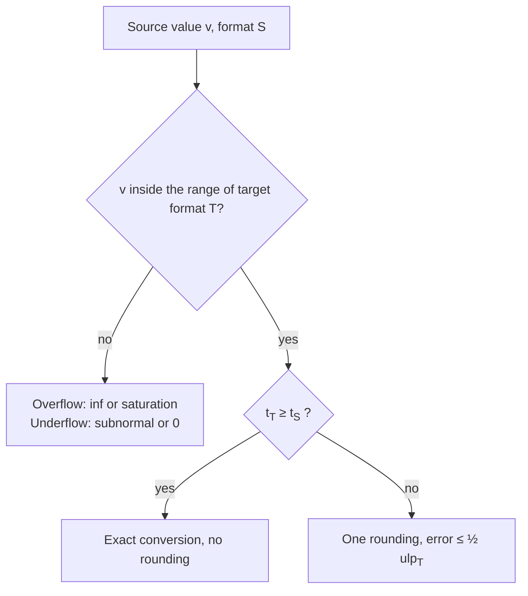

This post is the second in the floating-point series and covers rounding and conversion. Rounding takes a result of the same format that was computed with more bits back to the fixed width; conversion maps a value between formats, and going from a wide format to a narrow one usually rounds as well.

## Rounding

IEEE 754-2019 defines rounding as follows: every operation is equivalent to first producing an intermediate result of unbounded precision and unbounded range, then rounding that result to the destination format under some rounding mode. It guarantees that one operation produces one rounding.[1]

IEEE 754-2019 defines five rounding modes[2]:

| Attribute            | Abbrev. | C `fenv`             | PTX               | Semantics                   |
| ------------------- | --- | ---------------------- | ----------------- | ------------------------- |
| roundTiesToEven     | RNE | `FE_TONEAREST`         | `cvt.rn.*`        | round to nearest, ties to even: take the nearest neighbour; a tie goes to the neighbour whose least significant bit is 0 |
| roundTiesToAway     | RNA | `FE_TONEARESTFROMZERO` | `cvt.rna.*` (tf32) | round to nearest, ties away from zero: take the nearest neighbour; a tie goes to the larger magnitude |
| roundTowardPositive | RTP | `FE_UPWARD`            | `cvt.rp.*`        | round up, toward $+\infty$          |
| roundTowardNegative | RTN | `FE_DOWNWARD`          | `cvt.rm.*`        | round down, toward $-\infty$          |
| roundTowardZero     | RTZ | `FE_TOWARDZERO`        | `cvt.rz.*`        | round toward zero, that is, truncate the magnitude          |

`RNA` is the only rounding mode that need not be implemented.[3]

The first two are round-to-nearest modes and the last three are directed. The default floating-point rounding mode is the first.

### Rounding Error

The choice of rounding mode sets the size of the rounding error. Reusing the notation of [浮点数的表示](https://gucarpenter.github.io/blog/floating-point-representation/): $n$ is the number of fraction bits, $t=n+1$ is the number of significant bits, and $E$ is the decoded exponent.

For round-to-nearest the result is within half an ulp of the exact value. Inside a binade $|x|\in[2^{E},2^{E+1})$ the grid spacing is $\operatorname{ulp}(x)=2^{E-n}$, so

$$
|fl(x)-x| \le 2^{E-n-1},
$$

and $|x|\ge 2^{E}$, so dividing one by the other gives the relative error, which is also the default rounding error:

$$
\frac{|fl(x)-x|}{|x|} \le \frac{2^{E-n-1}}{2^{E}} = 2^{-n-1} = 2^{-t} =: u .
$$

The standard model of floating-point arithmetic follows[4]

$$
fl(x) = x(1+\delta), \qquad |\delta| \le u .
$$

For directed rounding the result can sit nearly a whole ulp away from the exact value, $|fl(x)-x|<\operatorname{ulp}(x)$, and the relative error becomes $|\delta|<2^{-n}=2u$.

Substituting $n$ gives the rounding error of each format:

| Format | $n$ | $t=n+1$ | $u=2^{-t}$ | $\epsilon_M=2^{-n}=\operatorname{ulp}(1)$ |
| --- | --- | --- | --- | --- |
| FP64 | 52 | 53 | $1.11\times10^{-16}$ | $2.22\times10^{-16}$ |
| FP32 | 23 | 24 | $5.96\times10^{-8}$ | $1.19\times10^{-7}$ |
| FP16 | 10 | 11 | $4.88\times10^{-4}$ | $9.77\times10^{-4}$ |
| TF32 | 10 | 11 | $4.88\times10^{-4}$ | $9.77\times10^{-4}$ |
| BF16 | 7 | 8 | $3.91\times10^{-3}$ | $7.81\times10^{-3}$ |

Machine epsilon is exactly twice the rounding error: $\epsilon_M=\operatorname{ulp}(1)=2u$. The two formulas give that directly; nothing about it is accidental.

### The Default Mode `RNE`

We can now answer why the default rounding mode is `RNE`. The analysis above shows round-to-nearest keeps half the error of a directed mode, so round-to-nearest is the better choice. Why `RNE` rather than `RNA`?

Assume ties occur symmetrically in both directions. If ties are always resolved the same way (`RNA`), the expected bias is $\tfrac12\operatorname{ulp}\times P(\text{tie})$ with a fixed sign, and in a long sum it can accumulate into a visible drift. With `RNE` the probability of rounding up equals the probability of rounding down, so the expected bias is 0[5]. Take the BF16 binade $[1, 2)$: the ulp is $2^{-7}$, the binade holds 128 tie midpoints, and under `RNE` 64 of them round to 1 and 64 round to 2. Under `RNA` all 128 round to 2.

### Truncation Mode `RTZ`

Where the precision requirement is looser, the truncation mode `RTZ` is also common. Truncation is simpler in hardware, so it is also faster.

## Conversion

Whether a conversion from a source format to a destination format is lossless depends on two dimensions, one fixing precision and one fixing range.

- **Significand**: $t_{\text{target}}\ge t_{\text{source}}$ is needed for a lossless result; otherwise one rounding is required;
- **Exponent range**: the destination must cover every value of the source; outside that range the value overflows or underflows.

Filling that scheme with real format pairs:

| | Significand enough $t_T \ge t_S$ | Significand too narrow $t_T < t_S$ |
| --- | --- | --- |
| **Range enough** | Exact: fp16→fp32, bf16→fp32, tf32→fp32 | One rounding: fp32→tf32, fp32→bf16, fp16→bf16 |
| **Range too narrow** | Exact but may leave the range: bf16→fp16 | One rounding, may leave the range: fp32→fp16 |

This already shows the difference between bf16 and fp16 mixed-precision training: the upward conversion to fp32 is lossless, and only the downward conversion back to bf16 costs one rounding. fp16 mixed precision pays a rounding error as well, and can leave the range.

### Three Lossy Conversions

Three lossy conversions follow from this:

| Form     | Test                  | Error                                             | Example (FP32 → FP16 RNE)                          |
| -------- | --------------------- | ------------------------------------------------- | ------------------------------------------------- |
| Loss of precision | lands inside the destination's normal range, off its grid | absolute $\le\tfrac12\operatorname{ulp}_T$, relative $\le u_T$ | —                                                 |
| Overflow | the unbounded rounding exceeds the largest finite value | unbounded | $65504\to65504$; $65520\to\infty$; $65536\to\infty$ |
| Underflow into the subnormal range | lands in $(0,2^{E_{\min}})$ | the absolute bound holds, the relative bound fails | $1.0\times10^{-5}\to1.00135803\times10^{-5}$      |

The loss-of-precision case is the rounding case analysed above: exactly one rounding error.

The overflow case was introduced in [浮点数的表示 › 上溢](https://gucarpenter.github.io/blog/floating-point-representation/); combining it with the rounding modes gives a sharper example. Three representative inputs go into FP32→FP16:

| Input | RNE | RNA | RTP | RTN | RTZ |
| --- | --- | --- | --- | --- | --- |
| $65519.9$ | $65504$ | $65504$ | $+\infty$ | $65504$ | $65504$ |
| $65520$ | $+\infty$ | $+\infty$ | $+\infty$ | $65504$ | $65504$ |
| $-65520$ | $-\infty$ | $-\infty$ | $-65504$ | $-\infty$ | $-65504$ |

Why 65520 is the special value: the last binade of FP16 is $[2^{15}, 2^{16})$ with spacing $ulp=2^{15-10}=32$, so the largest finite value is 65504, the next grid point is 65536, and the midpoint between them is 65520. Just below it every mode except RTP rounds normally to 65504, and RTP rounds up to infinity. At exactly 65520 only RTN, rounding down, and RTZ, rounding toward zero, come back to 65504. For -65520 the same holds with signs reversed: only RTP and RTZ reach -65504.[6]

The underflow case also appeared in [浮点数的表示 › 下溢](https://gucarpenter.github.io/blog/floating-point-representation/) and is the obscure one of the three. The smallest positive normal FP16 number is $2^{-14}\approx 6.10\times10^{-5}$ while the smallest positive normal FP32 number reaches $2^{-126}\approx 1.18\times10^{-38}$, so a value such as $1.0\times10^{-5}$ is normal in FP32 and can only be subnormal in FP16. FP16 has $E_{\min}=-14$ and $n=10$, so the subnormal spacing is $2^{-24}=5.9604645\times10^{-8}$. Dividing the input $10^{-5}$ by it gives

$$
\frac{10^{-5}}{2^{-24}} = 167.77216 ,
$$

round-to-nearest takes 168, so the result is $168\times 2^{-24} = 1.00135803\times10^{-5}$. That value has $n'=\lfloor\log_2 168\rfloor+1 = 8$ significant bits, three fewer than the 11 bits of the normal range — which is what "the relative bound fails" means concretely: the absolute spacing stays fixed at $2^{-24}$, so the smaller the magnitude, the looser the relative bound.

The rounding mode changes the underflowed value as well[7]. The discussion above assumed the default `RNE`; the table below writes each result as $k\cdot 2^{-24}$, where $2^{-24}=5.9604645\times10^{-8}$ is the subnormal spacing:

| Input (exact)             | RNE               | RNA               | RTP               | RTN                | RTZ                |
| --------------------- | ----------------- | ----------------- | ----------------- | ------------------ | ------------------ |
| $2^{-26}$             | $0$               | $0$               | $2^{-24}$         | $0$                | $0$                |
| $2^{-25}$ (tie)       | $0$               | $2^{-24}$         | $2^{-24}$         | $0$                | $0$                |
| $1.0\times10^{-5}$    | $168\cdot2^{-24}$ | $168\cdot2^{-24}$ | $168\cdot2^{-24}$ | $167\cdot2^{-24}$  | $167\cdot2^{-24}$  |
| $2^{-14}-2^{-25}$ (tie) | $2^{-14}$       | $2^{-14}$         | $2^{-14}$         | $1023\cdot2^{-24}$ | $1023\cdot2^{-24}$ |

## CUDA Support for Rounding and Conversion

### Intrinsics with an Explicit Rounding Mode

| intrinsic  | `_rn` | `_rz` | `_ru` | `_rd` |
| ---------- | ----- | ----- | ----- | ----- |
| `__fadd`   | ✓     | ✓     | ✓     | ✓     |
| `__fsub`   | ✓     | ✓     | ✓     | ✓     |
| `__fmul`   | ✓     | ✓     | ✓     | ✓     |
| `__fmaf`   | ✓     | ✓     | ✓     | ✓     |
| `__fdiv`   | ✓     | ✓     | ✓     | ✓     |
| `__frcp`   | ✓     | ✓     | ✓     | ✓     |
| `__fsqrt`  | ✓     | ✓     | ✓     | ✓     |
| `__frsqrt` | ✓     | —     | —     | —     |

Every intrinsic except the last supports all four rounding modes.[8]

### Narrow-Format Conversion

| Function             | `_rn` | `_rz` | `_ru` | `_rd` | No suffix |
| ------------------ | ----- | ----- | ----- | ----- | ------- |
| `__float2half`     | ✓     | ✓     | ✓     | ✓     | = `_rn` |
| `__float2bfloat16` | ✓     | ✓     | ✓     | ✓     | = `_rn` |
| `__half2float`     | —     | —     | —     | —     | exact, no rounding  |
| `__bfloat162float` | —     | —     | —     | —     | exact, no rounding  |

FP32→BF16 and FP32→FP16 likewise support all four rounding modes, and the reverse conversions need no rounding.[9]

## References

1. IEEE (2019), _IEEE Standard for Floating-Point Arithmetic_, IEEE Std 754-2019, §4.3 "Rounding-direction attributes", p. 27.
2. IEEE (2019), _IEEE Standard for Floating-Point Arithmetic_, §4.3.1 "Rounding-direction attributes to nearest" and §4.3.2 "Directed rounding attributes", pp. 27–28.
3. IEEE (2019), _IEEE Standard for Floating-Point Arithmetic_, §4.3.3 "Rounding attribute requirements", p. 28.
4. Nicholas J. Higham (2002), _Accuracy and Stability of Numerical Algorithms_, 2nd ed., §2.2 "Model of Arithmetic", p. 40.
5. Randal E. Bryant and David R. O'Hallaron (2016), _Computer Systems: A Programmer's Perspective_, 3rd ed., §2.4.4 "Rounding", pp. 156–157.
6. IEEE (2019), _IEEE Standard for Floating-Point Arithmetic_, §7.4 "Overflow", p. 53.
7. IEEE (2019), _IEEE Standard for Floating-Point Arithmetic_, §7.5 "Underflow", p. 53.
8. NVIDIA, _CUDA C++ Programming Guide_, §16.2 "Intrinsic Functions", Table 19, p. 406.
9. NVIDIA, _CUDA C++ Programming Guide_, §6.2.14.1.2 "16-Bit Floating-Point Textures", p. 86.
